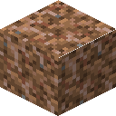
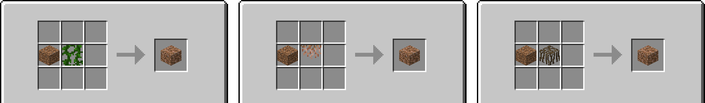

# Craftable Rooted Dirt



A data pack for Minecraft 26.2 and 26.3 that makes **rooted dirt** craftable. Dirt plus a **vine**, **hanging
roots** or **mangrove roots** gives one block of rooted dirt, so azalea trees no longer have to be found to get it.
It adds one recipe and nothing else; no mod loader is needed.



## Download

Get `craftablerooteddirt-<version>.zip` from
[CurseForge](https://www.curseforge.com/minecraft/data-packs/craftable-rooted-dirt) or the
[GitHub releases](../../releases) and put it into the `datapacks` folder of a world (`saves/<world>/datapacks/`),
or add it under *Data Packs* when creating a new world. On a server it goes into `world/datapacks/`. Works with
Minecraft 26.2 and 26.3, vanilla or with any mod loader.

## Crafting

Shapeless, anywhere in the grid:

```
D R      D = dirt
         R = vine, hanging roots or mangrove roots
```

gives one rooted dirt. The recipe is unlocked in the recipe book as soon as a vine, hanging roots or mangrove roots
are in the inventory.

Vanilla goes the other way too: using a hoe on rooted dirt turns it into dirt and drops hanging roots.

<!-- listing:skip -->
## Building

`tools/build.sh` → `build/craftablerooteddirt-<version>.zip` (the version is the top section of `CHANGELOG.md`).
`python3 tools/make-art.py <minecraft-client.jar>` draws `pack.png`, `docs/icon.png` and `docs/recipe.png` from the
vanilla textures.
<!-- listing:end -->

## License

MIT, see [LICENSE](LICENSE). By BaconCakeFactory.
